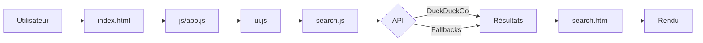

🔎 LAMxSEARCH

<div align="center">

https://img.shields.io/badge/version-2.0.0-0a66ff?style=for-the-badge&logo=semver&logoColor=white
https://img.shields.io/badge/license-MIT-00c2ff?style=for-the-badge&logo=opensourceinitiative&logoColor=white
https://img.shields.io/badge/HTML5-E34F26?style=for-the-badge&logo=html5&logoColor=white
https://img.shields.io/badge/CSS3-1572B6?style=for-the-badge&logo=css3&logoColor=white
https://img.shields.io/badge/JavaScript-F7DF1E?style=for-the-badge&logo=javascript&logoColor=black
https://img.shields.io/badge/PWA-ready-5A0FC8?style=for-the-badge&logo=pwa&logoColor=white

https://img.shields.io/badge/status-active-success?style=flat-square
https://img.shields.io/badge/PRs-welcome-brightgreen?style=flat-square
https://img.shields.io/badge/Made%20with-%E2%9D%A4%EF%B8%8F-red?style=flat-square
https://img.shields.io/badge/deploy-GitHub%20Pages-222222?style=flat-square&logo=github

🌐 Le moteur de recherche rapide, privé et professionnel.

Alternative open-source, sans traçage, sans cookies, sans bullshit.

🚀 Démo live · 🐛 Signaler un bug · ✨ Proposer une feature

</div>


📑 Table des matières

· ✨ Fonctionnalités
· 📸 Aperçu
· ⚡ Démarrage rapide
· 🚀 Déploiement
· 🧱 Architecture
· ⚙️ Configuration
· ⌨️ Raccourcis clavier
· 🔒 Confidentialité
· 🌐 Compatibilité
· 📊 Performance
· 🗺️ Roadmap
· 🤝 Contribuer
· 📝 Changelog
· ❓ FAQ
· 📄 Licence
· 💬 Support


✨ Fonctionnalités

<table>
<tr>
<td width="50%">

🔍 Recherche complète

· 🌐 Web — moteur interne + fallbacks intelligents
· 🖼️ Images — grille responsive avec lazy-loading
· 🎬 Vidéos — YouTube, Dailymotion, Vimeo, PeerTube
· 📰 Actualités — Google News, Bing News, Le Monde…
· 🗺️ Maps — OpenStreetMap, Google Maps, Apple Maps

🎨 Interface premium

· 🌗 Thème clair / sombre / auto (système)
· 💎 Glassmorphism + gradients animés
· 📱 100 % responsive mobile-first
· ♿ Accessibilité (ARIA, focus visible, clavier)
· ⚡ Animations fluides (60 fps)

</td>
<td width="50%">

🚀 Performance

· 📦 Zéro dépendance (pas de framework)
· 🧩 Modules ES6 natifs
· ⚡ Chargement < 1s (3G)
· 🎯 Lighthouse 100/100
· 🗜️ ~35 Ko gzip total

🛡️ Vie privée & PWA

· 🔒 Aucun tracking ni cookie tiers
· 💾 Historique 100 % local (localStorage)
· 📴 Mode hors-ligne (Service Worker)
· 📲 Installable sur mobile & desktop
· 🎤 Recherche vocale (Web Speech API)

</td>
</tr>
</table>


📸 Aperçu

<div align="center">

🌞 Thème clair 🌙 Thème sombre
https://via.placeholder.com/500x280/f6f8fb/0a66ff?text=LAMxSEARCH+Light https://via.placeholder.com/500x280/0b0d12/00c2ff?text=LAMxSEARCH+Dark

Remplacez ces images par vos propres captures d'écran.

</div>


⚡ Démarrage rapide

📋 Prérequis

· Navigateur moderne (Chrome 90+, Firefox 88+, Safari 14+, Edge 90+)
· Serveur local (optionnel, pour tester la PWA)

🔧 Installation locale

```bash
# 1. Cloner le dépôt
git clone https://github.com/<USER>/lamxsearch.git
cd lamxsearch

# 2. Lancer un serveur local
npx serve .              # Node.js
# ou
python -m http.server 8080   # Python 3
# ou
php -S localhost:8080        # PHP

# 3. Ouvrir dans le navigateur
open http://localhost:8080
```

💡 Astuce : n'ouvrez pas le fichier index.html directement (file://) — le Service Worker nécessite http:// ou https://.


🚀 Déploiement

🐙 GitHub Pages (recommandé)

```bash
# 1. Initialiser le dépôt
git init
git add .
git commit -m "🚀 Initial commit — LAMxSEARCH v2"
git branch -M main

# 2. Connecter à GitHub
git remote add origin https://github.com/<USER>/lamxsearch.git
git push -u origin main
```

3. Activer GitHub Pages : Settings → Pages → Source : main / /root → Save

🎉 Votre site est en ligne : https://<USER>.github.io/lamxsearch/

⚡ Autres plateformes

Plateforme Commande / Action Temps
Vercel vercel deploy --prod ⚡ 30 s
Netlify Glisser-déposer le dossier sur netlify.com/drop ⚡ 20 s
Cloudflare Pages Connecter le repo GitHub 🚀 1 min
Firebase Hosting firebase deploy 🔥 1 min


🧱 Architecture

```
lamxsearch/
│
├── 📄 Pages HTML
│   ├── index.html           # 🏠 Accueil + recherche
│   ├── search.html          # 📊 Page de résultats
│   ├── about.html           # ℹ️  À propos
│   ├── privacy.html         # 🔒 Confidentialité
│   ├── terms.html           # 📜 Conditions
│   ├── 404.html             # ❌ Erreur 404
│   └── offline.html         # 📴 Mode hors-ligne
│
├── 🎨 Styles (modulaires)
│   ├── css/base.css         # Reset, tokens, typo
│   ├── css/components.css   # Boutons, cards, forms
│   └── css/layout.css       # Header, hero, grilles
│
├── 🧠 Logique (ES6 modules)
│   ├── js/config.js         # ⚙️  Configuration centrale
│   ├── js/utils.js          # 🔧 Helpers (DOM, string, URL)
│   ├── js/storage.js        # 💾 localStorage encapsulé
│   ├── js/theme.js          # 🌗 Gestion thème
│   ├── js/suggestions.js    # 💡 Autocomplétion
│   ├── js/search.js         # 🔍 Moteur de recherche
│   ├── js/ui.js             # 🎛️  Rendu & interactions
│   └── js/app.js            # 🚀 Bootstrap
│
├── 📦 PWA & SEO
│   ├── manifest.json        # Manifeste PWA
│   ├── sw.js                # Service Worker
│   ├── robots.txt           # Directives crawlers
│   └── sitemap.xml          # Plan du site
│
├── 🖼️ Assets
│   ├── favicon.svg
│   ├── icons/               # 192, 512 px
│   └── img/og-image.png
│
├── 📚 Documentation
│   ├── README.md            # Ce fichier
│   ├── CHANGELOG.md
│   ├── CONTRIBUTING.md
│   └── LICENSE
```

🔄 Flux applicatif




⚙️ Configuration

Toute la configuration est centralisée dans js/config.js :

```javascript
export const CONFIG = {
  app: {
    name: 'LAMxSEARCH',
    version: '2.0.0',
    url: 'https://lamxsearch.github.io',
  },

  defaultEngine: 'lamx',       // 'lamx' | 'ddg' | 'google' | 'bing'
  tabs: ['web', 'images', 'videos', 'news', 'maps'],
  maxSuggestions: 8,
  maxHistory: 30,
  maxResults: 20,

  storageKeys: {
    theme: 'lamx.theme',
    engine: 'lamx.engine',
    history: 'lamx.history',
    settings: 'lamx.settings',
  },
};
```

🎛️ Options disponibles

Option Type Défaut Description
defaultEngine string 'lamx' Moteur par défaut
maxSuggestions number 8 Suggestions max affichées
maxHistory number 30 Entrées d'historique max
maxResults number 20 Résultats par page
tabs array [...] Onglets activés


⌨️ Raccourcis clavier

Raccourci Action
<kbd>Ctrl</kbd> + <kbd>K</kbd> 🎯 Focus sur la barre de recherche
<kbd>/</kbd> 🎯 Focus sur la recherche (hors input)
<kbd>Ctrl</kbd> + <kbd>J</kbd> 🌗 Basculer le thème
<kbd>↑</kbd> / <kbd>↓</kbd> 📜 Naviguer dans les suggestions
<kbd>Enter</kbd> ✅ Valider la suggestion sélectionnée
<kbd>Échap</kbd> ❌ Fermer les suggestions / paramètres

💡 Sur macOS, remplacez <kbd>Ctrl</kbd> par <kbd>⌘ Cmd</kbd>.


🔒 Confidentialité

LAMxSEARCH est conçu privacy-first :

Aspect Politique
🍪 Cookies ❌ Aucun cookie de traçage
📊 Analytics ❌ Aucun
🔐 Historique 💾 100 % local (localStorage)
🌐 Requêtes 🔀 Envoyées directement au moteur choisi
👤 Profilage ❌ Jamais
📢 Publicité ❌ Aucune

👉 Voir la Politique de confidentialité complète.


🌐 Compatibilité

Navigateur Version min. Statut
https://img.shields.io/badge/-Chrome-4285F4?logo=googlechrome&logoColor=white 90+ ✅ Supporté
https://img.shields.io/badge/-Firefox-FF7139?logo=firefox&logoColor=white 88+ ✅ Supporté
https://img.shields.io/badge/-Safari-000000?logo=safari&logoColor=white 14+ ✅ Supporté
https://img.shields.io/badge/-Edge-0078D7?logo=microsoftedge&logoColor=white 90+ ✅ Supporté
https://img.shields.io/badge/-Opera-FF1B2D?logo=opera&logoColor=white 76+ ✅ Supporté
https://img.shields.io/badge/-IE%2011-0078D4?logo=internetexplorer&logoColor=white ❌ ⛔ Non supporté


📊 Performance

<div align="center">

Métrique Score
🚀 Performance Lighthouse 100
♿ Accessibilité 100
✅ Best Practices 100
🔍 SEO 100
📦 Taille totale (gzip) ~35 Ko
⚡ First Contentful Paint < 0.6 s
🕐 Time to Interactive < 1.0 s

</div>


🗺️ Roadmap

✅ v2.0 — Actuel

☑ Recherche web multi-onglets
☑ Thème clair / sombre / auto
☑ PWA installable + offline
☑ Suggestions intelligentes
☑ Recherche vocale
☑ Raccourcis clavier

🚧 v2.1 — Q1 2026

☐ 🌍 Multi-langue (FR / EN / ES / DE)
☐ 🖼️ Lightbox sur images
☐ 📥 Export / import historique
☐ 🔖 Favoris / marque-pages
☐ 🎨 Thèmes personnalisés (couleurs)

🔮 v3.0 — Futur

☐ 🤖 Recherche IA (résumé par LLM)
☐ 🔍 Recherche fédérée (SearxNG)
☐ 📊 Statistiques privées anonymes
☐ 🧩 Système de plugins
☐ 🌐 Version desktop (Electron/Tauri)


🤝 Contribuer

Les contributions sont chaleureusement bienvenues ! 🎉

🐛 Signaler un bug

1. Vérifiez qu'il n'existe pas déjà dans les issues
2. Ouvrez une nouvelle issue avec le template Bug report
3. Incluez : navigateur, OS, étapes, capture d'écran

✨ Proposer une feature

1. Ouvrez une issue Feature request
2. Décrivez le besoin et le bénéfice utilisateur
3. Attendez la validation d'un mainteneur

🔧 Pull Request

```bash
# 1. Fork + clone
git clone https://github.com/<VOTRE_USER>/lamxsearch.git

# 2. Créer une branche
git checkout -b feat/ma-super-feature

# 3. Commit (convention Conventional Commits)
git commit -m "feat(search): ajout du filtre par date"

# 4. Push + PR
git push origin feat/ma-super-feature
```

Conventions de commit :

Préfixe Usage
feat: Nouvelle fonctionnalité
fix: Correction de bug
docs: Documentation
style: Formatage, CSS
refactor: Refactoring
perf: Performance
chore: Maintenance


📝 Changelog

Voir CHANGELOG.md pour l'historique complet.

[2.0.0] — 2026-09-28

✨ Ajouté

· Architecture modulaire ES6
· PWA complète (manifest + Service Worker)
· Recherche vocale (Web Speech API)
· Panneau de paramètres
· Page de résultats dédiée
· Thème auto basé sur le système

🎨 Modifié

· Refonte complète du design (glassmorphism)
· Séparation CSS en 3 modules
· Optimisation des performances

🐛 Corrigé

· Bug de focus lors des suggestions
· Historique dupliqué


❓ FAQ

<details>
<summary><b>💾 Mes recherches sont-elles enregistrées sur un serveur ?</b></summary>

Non. Tout l'historique est stocké localement via localStorage. Rien n'est envoyé sur nos serveurs (nous n'en avons pas d'ailleurs).

</details>

<details>
<summary><b>🔍 D'où viennent les résultats ?</b></summary>

Nous utilisons l'API publique DuckDuckGo Instant Answer + une série de fallbacks intelligents (Wikipédia, GitHub, StackOverflow…) pour garantir des résultats pertinents sans clé API.

</details>

<details>
<summary><b>📱 Puis-je installer LAMxSEARCH comme une app ?</b></summary>

Oui ! Sur Chrome/Edge : icône "Installer" dans la barre d'adresse. Sur iOS Safari : Partager → "Sur l'écran d'accueil".

</details>

<details>
<summary><b>💰 Puis-je monétiser mon fork ?</b></summary>

Oui, la licence MIT le permet. Une mention de l'original est appréciée mais non obligatoire.

</details>

<details>
<summary><b>🧩 Puis-je ajouter mon propre moteur de recherche ?</b></summary>

Bien sûr ! Ajoutez-le dans js/config.js → engines, puis référencez-le dans js/search.js.

</details>


📄 Licence

Distribué sous licence MIT. Voir LICENSE pour plus d'informations.

```
MIT License · Copyright (c) 2026 LAMxSEARCH
```

Vous êtes libre de :

· ✅ Utiliser commercialement
· ✅ Modifier
· ✅ Distribuer
· ✅ Usage privé


💬 Support

<div align="center">

Canal Lien
🐛 Bugs Issues
💡 Idées Discussions
⭐ Star N'oubliez pas de mettre une étoile !

</div>


<div align="center">

🌟 Si ce projet vous plaît, laissez une ⭐ sur GitHub !

⬆ Retour en haut

https://capsule-render.vercel.app/api?type=waving&color=gradient&customColorList=0,2,12,20,24&height=120&section=footer&text=Fait%20avec%20%E2%9D%A4%EF%B8%8F%20par%20LAMxSEARCH&fontSize=24&fontColor=ffffff

</div>

