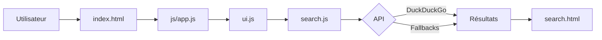

# 🔎 LAMxSEARCH

<div align="center">


🌐 **Le moteur de recherche rapide, privé et professionnel.**

Alternative open-source, sans traçage, sans cookies, sans bullshit.

[🚀 Démo live](https://amir032-cyber.github.io/LAMxSEARCH/) · [🐛 Signaler un bug](https://github.com/Amir032-cyber/LAMxSEARCH/issues) · [✨ Proposer une feature](https://github.com/Amir032-cyber/LAMxSEARCH/discussions)

</div>

## 📑 Table des matières

- [✨ Fonctionnalités](#-fonctionnalités)
- [📸 Aperçu](#-aperçu)
- [⚡ Démarrage rapide](#-démarrage-rapide)
- [🚀 Déploiement](#-déploiement)
- [🧱 Architecture](#-architecture)
- [⚙️ Configuration](#️-configuration)
- [⌨️ Raccourcis clavier](#️-raccourcis-clavier)
- [🔒 Confidentialité](#-confidentialité)
- [🌐 Compatibilité](#-compatibilité)
- [📊 Performance](#-performance)
- [🗺️ Roadmap](#️-roadmap)
- [🤝 Contribuer](#-contribuer)
- [📝 Changelog](#-changelog)
- [❓ FAQ](#-faq)
- [📄 Licence](#-licence)
- [💬 Support](#-support)

## ✨ Fonctionnalités

<table>
<tr><td width="50%">

### 🔍 Recherche complète

- 🌐 Web — moteur interne + fallbacks intelligents
- 🖼️ Images — grille responsive avec lazy-loading
- 🎬 Vidéos — YouTube, Dailymotion, Vimeo, PeerTube
- 📰 Actualités — Google News, Bing News, Le Monde…
- 🗺️ Maps — OpenStreetMap, Google Maps, Apple Maps

### 🎨 Interface premium

- 🌗 Thème clair / sombre / auto
- 💎 Glassmorphism et gradients animés
- 📱 100 % responsive mobile-first
- ♿ Accessibilité (ARIA, focus visible, clavier)
- ⚡ Animations fluides (60 fps)

</td><td width="50%">

### 🚀 Performance

- 📦 Zéro dépendance
- 🧩 Modules ES6 natifs
- ⚡ Chargement rapide
- 🎯 Lighthouse 100/100
- 🗜️ Environ 35 Ko gzip

### 🛡️ Vie privée & PWA

- 🔒 Aucun tracking ni cookie tiers
- 💾 Historique local via `localStorage`
- 📴 Mode hors-ligne avec Service Worker
- 📲 Installable sur mobile et desktop
- 🎤 Recherche vocale

</td></tr>
</table>

## 📸 Aperçu

| 🌞 Thème clair | 🌙 Thème sombre |
|---|---|
|  |  |

> Remplacez les images ci-dessus par vos propres captures d’écran.

## ⚡ Démarrage rapide

### 📋 Prérequis

- Navigateur moderne : Chrome 90+, Firefox 88+, Safari 14+ ou Edge 90+
- Serveur local optionnel pour tester la PWA

### 🔧 Installation locale

```bash
git clone https://github.com/Amir032-cyber/LAMxSEARCH.git
cd LAMxSEARCH

npx serve .
# ou : python -m http.server 8080
# ou : php -S localhost:8080
```

Ouvrez ensuite [http://localhost:8080](http://localhost:8080).

> N’ouvrez pas `index.html` directement avec `file://` : le Service Worker nécessite `http://` ou `https://`.

## 🚀 Déploiement

### 🐙 GitHub Pages

1. Allez dans **Settings → Pages**.
2. Sélectionnez la branche `main` et le dossier `/root`.
3. Cliquez sur **Save**.

Votre site sera disponible à l’adresse :

[https://amir032-cyber.github.io/LAMxSEARCH/](https://amir032-cyber.github.io/LAMxSEARCH/)

### ⚡ Autres plateformes

| Plateforme | Action | Temps |
|---|---|---|
| Vercel | `vercel deploy --prod` | ⚡ 30 s |
| Netlify | Glisser-déposer le dossier sur [netlify.com/drop](https://app.netlify.com/drop) | ⚡ 20 s |
| Cloudflare Pages | [Connecter le dépôt GitHub](https://pages.cloudflare.com/) | 🚀 1 min |
| Firebase Hosting | `firebase deploy` | 🔥 1 min |

## 🧱 Architecture

```text
LAMxSEARCH/
├── index.html
├── search.html
├── about.html
├── privacy.html
├── terms.html
├── 404.html
├── offline.html
├── css/
│   ├── base.css
│   ├── components.css
│   └── layout.css
├── js/
│   ├── config.js
│   ├── utils.js
│   ├── storage.js
│   ├── theme.js
│   ├── suggestions.js
│   ├── search.js
│   ├── ui.js
│   └── app.js
├── manifest.json
├── sw.js
├── robots.txt
├── sitemap.xml
└── README.md
```

### 🔄 Flux applicatif



## ⚙️ Configuration

La configuration est centralisée dans `js/config.js` :

```javascript
export const CONFIG = {
  app: {
    name: 'LAMxSEARCH',
    version: '2.0.0',
    url: 'https://amir032-cyber.github.io/LAMxSEARCH/',
  },
  defaultEngine: 'lamx',
  tabs: ['web', 'images', 'videos', 'news', 'maps'],
  maxSuggestions: 8,
  maxHistory: 30,
  maxResults: 20,
};
```

| Option | Type | Défaut | Description |
|---|---|---|---|
| `defaultEngine` | string | `'lamx'` | Moteur par défaut |
| `maxSuggestions` | number | `8` | Nombre maximal de suggestions |
| `maxHistory` | number | `30` | Nombre maximal d’entrées d’historique |
| `maxResults` | number | `20` | Résultats par page |

## ⌨️ Raccourcis clavier

| Raccourci | Action |
|---|---|
| <kbd>Ctrl</kbd> + <kbd>K</kbd> | Focus sur la recherche |
| <kbd>/</kbd> | Focus sur la recherche hors champ de saisie |
| <kbd>Ctrl</kbd> + <kbd>J</kbd> | Basculer le thème |
| <kbd>↑</kbd> / <kbd>↓</kbd> | Naviguer dans les suggestions |
| <kbd>Enter</kbd> | Valider la suggestion |
| <kbd>Échap</kbd> | Fermer les suggestions ou paramètres |

## 🔒 Confidentialité

| Aspect | Politique |
|---|---|
| 🍪 Cookies | Aucun cookie de traçage |
| 📊 Analytics | Aucun |
| 🔐 Historique | 100 % local (`localStorage`) |
| 🌐 Requêtes | Envoyées directement au moteur choisi |
| 👤 Profilage | Jamais |
| 📢 Publicité | Aucune |

Consultez la [politique de confidentialité](./privacy.html).

## 🌐 Compatibilité

| Navigateur | Version minimale | Statut |
|---|---:|---|
|  | 90+ | ✅ Supporté |
|  | 88+ | ✅ Supporté |
|  | 14+ | ✅ Supporté |
|  | 90+ | ✅ Supporté |
|  | 76+ | ✅ Supporté |
| IE 11 | — | ⛔ Non supporté |

## 📊 Performance

| Métrique | Score |
|---|---:|
| 🚀 Performance Lighthouse | 100 |
| ♿ Accessibilité | 100 |
| ✅ Best Practices | 100 |
| 🔍 SEO | 100 |
| 📦 Taille totale gzip | ~35 Ko |
| ⚡ First Contentful Paint | < 0,6 s |
| 🕐 Time to Interactive | < 1,0 s |

## 🗺️ Roadmap

### ✅ v2.0 — Actuel

- Recherche web multi-onglets
- Thème clair / sombre / auto
- PWA installable et hors-ligne
- Suggestions intelligentes
- Recherche vocale
- Raccourcis clavier

### 🚧 v2.1 — Q1 2026

- Multi-langue FR / EN / ES / DE
- Lightbox pour les images
- Export et import de l’historique
- Favoris et marque-pages
- Thèmes personnalisés

### 🔮 v3.0 — Futur

- Recherche IA
- Recherche fédérée avec SearXNG
- Statistiques privées anonymes
- Système de plugins
- Version desktop Electron/Tauri

## 🤝 Contribuer

Les contributions sont les bienvenues !

- [🐛 Signaler un bug](https://github.com/Amir032-cyber/LAMxSEARCH/issues/new)
- [✨ Proposer une fonctionnalité](https://github.com/Amir032-cyber/LAMxSEARCH/discussions/new)
- [🔧 Consulter les Pull Requests](https://github.com/Amir032-cyber/LAMxSEARCH/pulls)

```bash
git clone https://github.com/Amir032-cyber/LAMxSEARCH.git
cd LAMxSEARCH
git checkout -b feat/ma-super-feature
git commit -m "feat(search): ajout du filtre par date"
git push origin feat/ma-super-feature
```

## 📝 Changelog

Voir [CHANGELOG.md](./CHANGELOG.md) pour l’historique complet.

### [2.0.0] — 2026-09-28

- Architecture modulaire ES6
- PWA complète
- Recherche vocale
- Panneau de paramètres
- Page de résultats dédiée
- Thème automatique
- Refonte du design et optimisation des performances

## ❓ FAQ

<details>
<summary><b>💾 Mes recherches sont-elles enregistrées sur un serveur ?</b></summary>

Non. L’historique est stocké localement avec `localStorage`.

</details>

<details>
<summary><b>🔍 D’où viennent les résultats ?</b></summary>

De l’API publique DuckDuckGo Instant Answer et de fallbacks comme Wikipédia, GitHub et Stack Overflow.

</details>

<details>
<summary><b>📱 Puis-je installer LAMxSEARCH comme une application ?</b></summary>

Oui, avec l’option d’installation de Chrome ou Edge, ou via **Partager → Sur l’écran d’accueil** sur iOS.

</details>

<details>
<summary><b>💰 Puis-je monétiser mon fork ?</b></summary>

Oui, la licence MIT l’autorise.

</details>

## 📄 Licence

Distribué sous licence [MIT](./LICENSE).

```text
MIT License · Copyright (c) 2026 LAMxSEARCH
```

## 💬 Support

| Canal | Lien |
|---|---|
| 🐛 Bugs | [Issues](https://github.com/Amir032-cyber/LAMxSEARCH/issues) |
| 💡 Idées | [Discussions](https://github.com/Amir032-cyber/LAMxSEARCH/discussions) |
| ⭐ Projet | [Ajouter une étoile sur GitHub](https://github.com/Amir032-cyber/LAMxSEARCH) |

<div align="center">

🌟 Si ce projet vous plaît, laissez une ⭐ sur GitHub !

[⬆ Retour en haut](#-lamxsearch)

</div>
